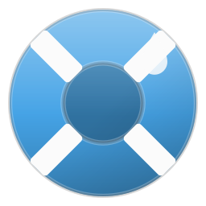

* Carvoeiro Water Fun

#+attr_html: :width 160 :alt Carvoeiro Water Fun logo

------------------

* Documentation
:PROPERTIES:
:CUSTOM_ID: documentation
:END:

The source of this site is the modules under ~src/carvoeiro-water-fun~, and
their reference is generated rather than written: ~maak docs~ runs
[[https://github.com/jjba23/guile-dokgen][dokgen]] over them and renders the chapter
to ~doc/api-dist/index.html~, drawing every mermaid diagram a module's
commentary carries.  ~maak diagrams~ renders every mermaid source under
~resources/diagrams~ to the SVG beside it.

#+attr_html: :width 720 :alt One locale built: options, renderer, page and the assets copied beside it

~maak build~ calls ~main~ once per locale (~en_US~ and ~pt_PT~), and each call
renders one page: ~render-page~ sets the locale up, asks
~(carvoeiro-water-fun html)~ for the page, copies the stylesheets, the scripts,
the fonts and the pictures the page names into the output directory, and writes
~index.html~ there.  The diagram's source is
[[file:resources/diagrams/build.mmd][resources/diagrams/build.mmd]].

------------------

* Licensing
:PROPERTIES:
:CUSTOM_ID: licensing
:END:

This project, and Git repository, and all of its source code are free and open software, licensed under the [[https://opensource.org/license/mit][MIT License]]

The documentation and examples, including this document, which are provided, are all licensed under the [[https://creativecommons.org/licenses/by/4.0/][CC BY 4.0 (Creative Commons Attribution)]] license.

------------------

* AI Policy
:PROPERTIES:
:CUSTOM_ID: ai-policy
:END:

This project follows the [[https://jointhefreeworld.org/ai-policy/][jointhefreeworld AI policy]].
[[file:AI_POLICY.md][AI_POLICY.md]] holds the short version; the full policy is the link above.

------------------

* Code of conduct
:PROPERTIES:
:CUSTOM_ID: code-of-conduct
:END:

This project adheres to the jointhefreeworld code of conduct. Find it here:

https://jointhefreeworld.org/blog/articles/personal/jointhefreeworld-code-of-conduct/index.html

In summary, we foster an inclusive, respectful, and cooperative environment for
all contributors and users of this free software project. Inspired by the ideals
of the GNU Project, we strive to uphold freedom, equality, and community as
guiding principles. We believe that collaboration in a community of mutual
respect is essential to creating excellent free software.

------------------
