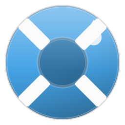

* Carvoeiro Water Fun

#+attr_html: :width 160 :alt Carvoeiro Water Fun logo

------------------

* Licensing
:PROPERTIES:
:CUSTOM_ID: licensing
:END:

This project, and Git repository, and all of its source code are free and open software, licensed under the [[https://opensource.org/license/mit][MIT License]]

The documentation and examples, including this document, which are provided, are all licensed under the [[https://creativecommons.org/licenses/by/4.0/][CC BY 4.0 (Creative Commons Attribution)]] license.

------------------

* AI Policy
:PROPERTIES:
:CUSTOM_ID: ai-policy
:END:

This project follows the [[https://jointhefreeworld.org/ai-policy/][jointhefreeworld AI policy]].
[[file:AI_POLICY.md][AI_POLICY.md]] holds the short version; the full policy is the link above.

------------------

* Code of conduct
:PROPERTIES:
:CUSTOM_ID: code-of-conduct
:END:

This project adheres to the jointhefreeworld code of conduct. Find it here:

https://jointhefreeworld.org/blog/articles/personal/jointhefreeworld-code-of-conduct/index.html

In summary, we foster an inclusive, respectful, and cooperative environment for
all contributors and users of this free software project. Inspired by the ideals
of the GNU Project, we strive to uphold freedom, equality, and community as
guiding principles. We believe that collaboration in a community of mutual
respect is essential to creating excellent free software.

------------------
